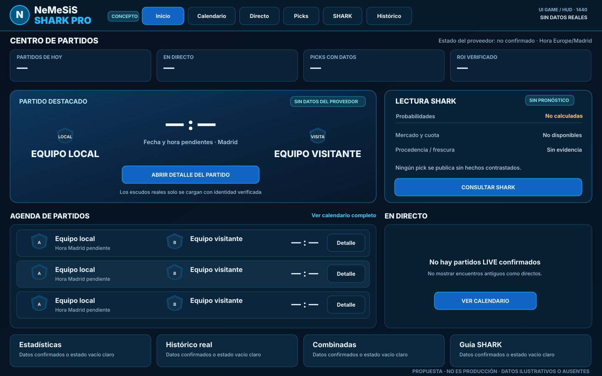
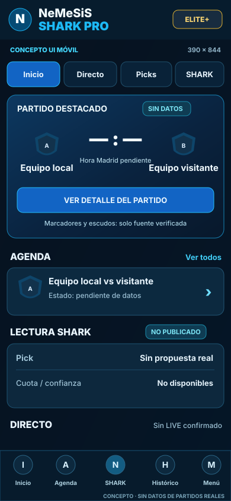

# NeMeSiS SHARK PRO · Game UI / HUD · entrega de conceptos

**Origen:** bocetos estructurales originales creados en ChatGPT el 1/11/2026 y añadidos a la rama EXISTENTE de la PR #305. **NO son capturas, no demuestran implementación y no contienen hechos deportivos.** No copiar cuotas ni porcentajes de las imágenes ilustrativas previas a ninguna pantalla productiva.

## Objetivo de trabajo real
Convertir la estética premium oscuro/azul/cian en un sistema visual deportivo utilizable: identificar partido en menos de un vistazo, escudo/nombre visibles, resultado/fecha Madrid prioritarios, datos pendientes explícitos, análisis SHARK con procedencia, navegación simple y un Admin separado del cliente. Proteger rendimiento y accesibilidad por encima de efectos.

## Especialistas Game UI existentes y entregable verificable
| Función | Evidencia a entregar |
|---|---|
| Dirección de arte interactiva | Paleta, marca SHARK, tipografía, diseño de superficie y estado vacío, licencia de assets |
| Diseñador HUD deportivo | Orden de equipos/escudos/marcador/minuto/mercados; lectura instantánea sin sobresaturación |
| UX de estrategia/simulación | Arquitectura Inicio/Calendario/Live/Picks/SHARK/Histórico; primer viewport útil |
| Motion designer | Estados, microfeedback, `prefers-reduced-motion`, animaciones nunca obligatorias |
| Experto táctil/móvil y teclado | 320/390/768 px, safe-area, 44px targets, foco visible, zero occlusion |
| Especialista de rendimiento | CSS/JS, LCP/INP, TTFB, subrecursos y progresivo; no incrementar 502 |
| QA visual independiente | Capturas `REAL_RENDER`/`LOCAL_CI`, overlay antes/después exact SHA, señalización de falsas evidencias |

## Dos funciones de contraste por cada disciplina
**A)** Verificador de evidencias: captura de navegador real, geometría, jerarquía, fecha, SHA, identidad de los escudos y cobertura. **B)** Revisor adversarial: intenta refutar cada PASS con 320/390/768/1440, datos largos, vacío/stale, FREE/PRO/ELITE/ELITE+, dark/light cuando corresponda, admin separado, accesibilidad y rendimiento. Un quórum 2/3 con la misma evidencia NO equivale a confirmación independiente.

## Cobertura obligatoria (sin crear otra plataforma ni nuevos panels)
- Home `/` y `/app`: CTA correcto, tres bloques de información, cero card vacía decorativa, distinguir estado sin proveedor.
- Calendario, partidos, Live: identidades, fechas Madrid, gol/minuto según período, eventos reales; fotos de escudos autorizadas y fallback honesto.
- Picks, combinadas, match detail, resultados, Track Record: cuota con timestamp o «pendiente», confianza calculada o ausente, ROI solo con resultados cerrados.
- SHARK: procedencia/riesgos, estado del proveedor IA, copy explicativo no repetitivo.
- Telegram/planes/registro: no prometer envíos ni prestaciones sin recibo; precio y entitlements reales.
- Admin, Company OS, finanzas: jerarquía específica de administración y controles de datos reales; no barra de cliente.
- Pantallas 320, 390, 768, 1440; scroll vertical; cero desbordamiento, botones no ocultos, sin duplicación de navegación, contraste WCAG AA y targets >=44 px donde aplique.
- Screenshots y ZIP de QA **del mismo SHA** antes y después; si no hay autenticación, `ADMIN_NOT_CAPTURED`; no atribuir concepto a producción.

## Puertas y alcance
Los SVG son propuestas editables. No desplegar ni fusionar sin 1) revisión de los bocetos por el propietario; 2) un único integrador con tareas de modificación acotadas; 3) CI y Playwright, sin cambiar aserciones para pasar; 4) Render exact SHA y capturas reales. No tocar pagos, secretos, DB, cron, Telegram, datos históricos ni añadir APIs.
